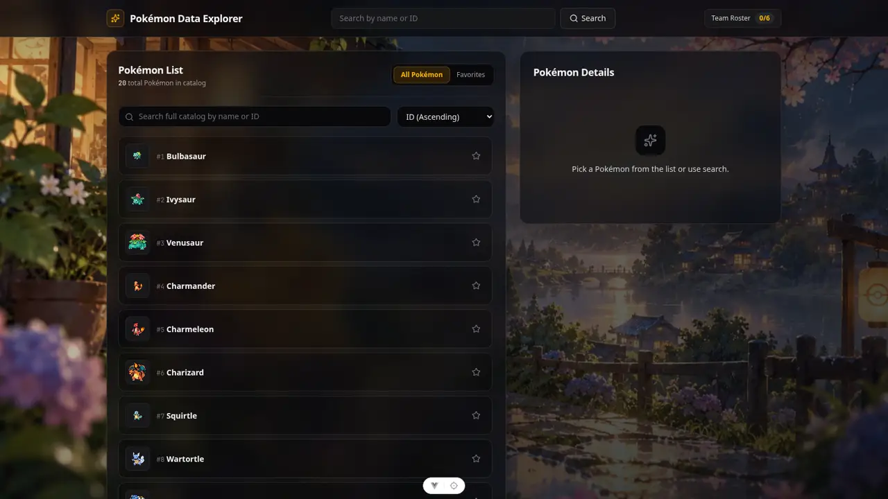
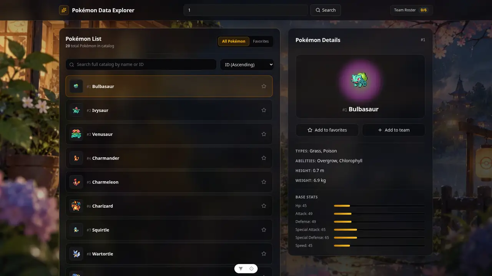
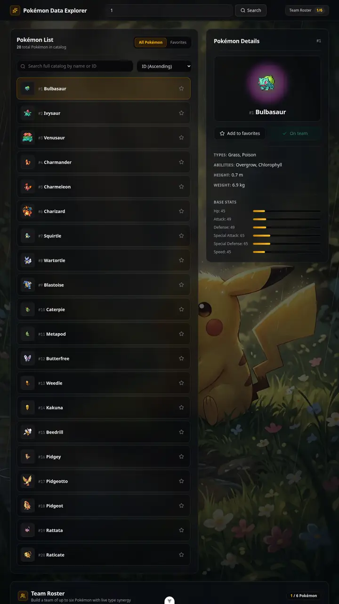
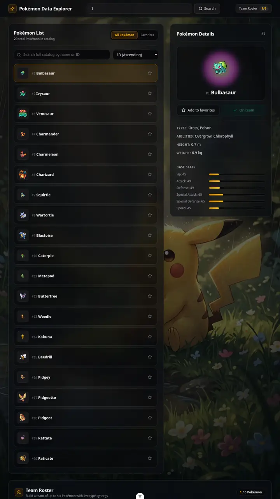
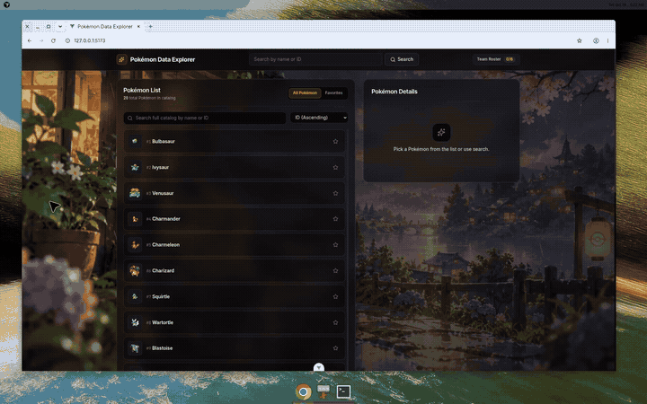

# Pokémon Data Explorer

[](https://github.com/rimkahan888/pokemon-api-dotnet/actions/workflows/ci.yml)

`pokemon-api-dotnet` is an ASP.NET Core Web API and Vue 3 frontend for browsing Pokémon from [PokéAPI](https://pokeapi.co/). Search by name or ID, page through the catalog, save favorites, and build a team of six.

## Clone

```bash
git clone https://github.com/rimkahan888/pokemon-api-dotnet.git
cd pokemon-api-dotnet
```

## Stack
- Backend: ASP.NET Core Web API
- External API integration: [PokéAPI](https://pokeapi.co/)
- Frontend: Vue 3 + Vite + TypeScript

## Features (MVP)
- Search Pokémon by name or ID
- Paginated Pokémon list and catalog-wide search
- Pokémon detail panel (types, abilities, stats, sprite)
- Favorites and a six-Pokémon team with type coverage and shared weaknesses
- Backend caching and retry/timeout handling for PokéAPI calls
- Loading/error states in frontend
- Animated porch and forest backgrounds, with glass panels that respect reduced motion

## Architecture

```text
pokemon-ui (Vue) -- /api --> PokemonController --> PokemonService --> PokeApiClient --> PokéAPI
```

The Vue app calls same-origin `/api` routes. In development, Vite proxies those requests to the API on port 5010. `PokemonController` checks page, size, and search input. `PokemonService` maps PokéAPI payloads into the DTOs the UI renders and caches list, detail, and catalog responses in memory. `PokeApiClient` applies the configured timeout and retries transient upstream failures. Favorites and the team roster stay in the browser's `localStorage`.

## Gallery

Landscape and desktop windows use the sunset porch. Portrait windows, including phones and a vertical monitor, use the rainy forest pond. Both paintings are served as AVIF, WebP, and JPEG. Canvas rain, light, dust or petals, and ripples sit on top of the picture, and they pause when reduced motion is requested or the tab is hidden. The panels are dark glass so the type and stat text stay readable. On a wide screen, Pikachu stays visible along the left side of the porch.

### Scenes

| Forest pond (portrait) | Village porch (landscape) |
| --- | --- |
|  |  |

### Explorer









Rain, lantern light, and opening a Pokémon:



## Incremental planning docs
- `docs/roadmap.md`
- `docs/pr-plan.md`

## Frontend handoff

[`docs/frontend-handoff/FRONTEND_BRIEF.md`](docs/frontend-handoff/FRONTEND_BRIEF.md) is a self-contained brief for generating a replacement UI against this API. The captured OpenAPI document is [`docs/frontend-handoff/openapi.json`](docs/frontend-handoff/openapi.json). Regenerate it with `docs/frontend-handoff/export-openapi.sh`.

## Project Structure
- `PokemonApi.sln` – Root .NET solution
- `PokemonApi` – C# backend
- `PokemonApi.Tests` – C# unit test suite
- `pokemon-ui` – Vue frontend

## Run Locally

### 1) Backend API & Tests
```bash
# Build and run tests
dotnet test PokemonApi.sln

# Run backend API
dotnet run --project PokemonApi
```
Backend listens on `http://localhost:5010` in development.
The health check is available at `GET /health`.

### 2) Frontend
```bash
cd pokemon-ui
npm ci
npm run dev
```
Frontend runs on Vite and proxies `/api/*` requests to `http://localhost:5010`; start the backend in a separate terminal first. Run frontend checks with `npm run build` and `npm test` from `pokemon-ui`.

## API Endpoints
- `GET /health`
- `GET /api/pokemon/{nameOrId}`
- `GET /api/pokemon?page={n}&size={m}`
- `GET /api/pokemon?search={query}&page={n}&size={m}` — catalog search by name or ID. `page` is at least 1 and `size` is from 1 to 100.
