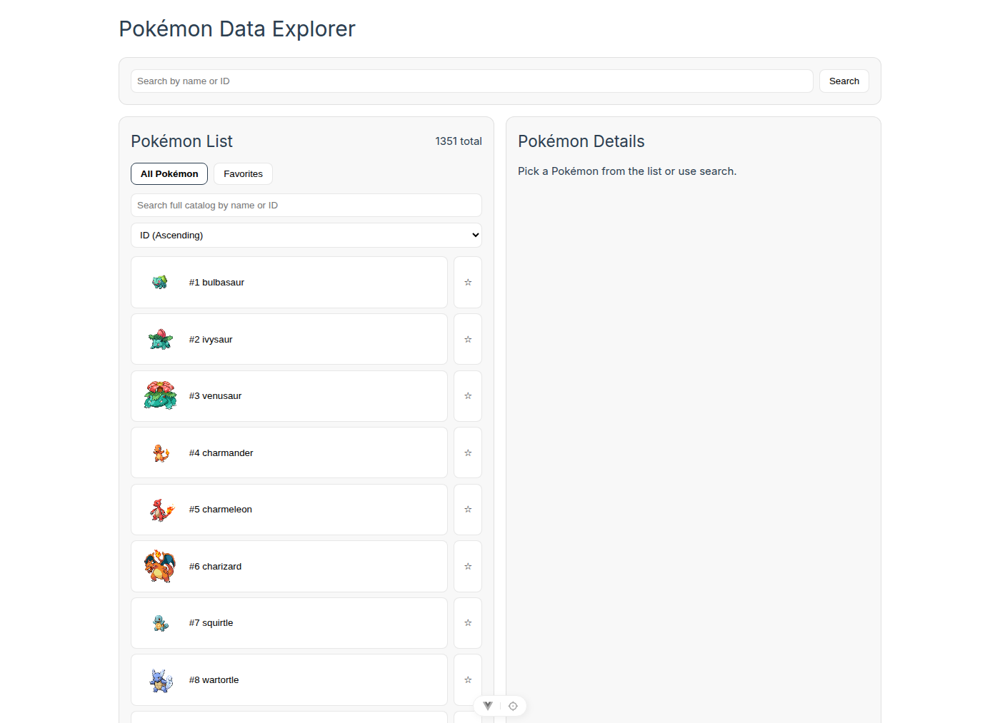
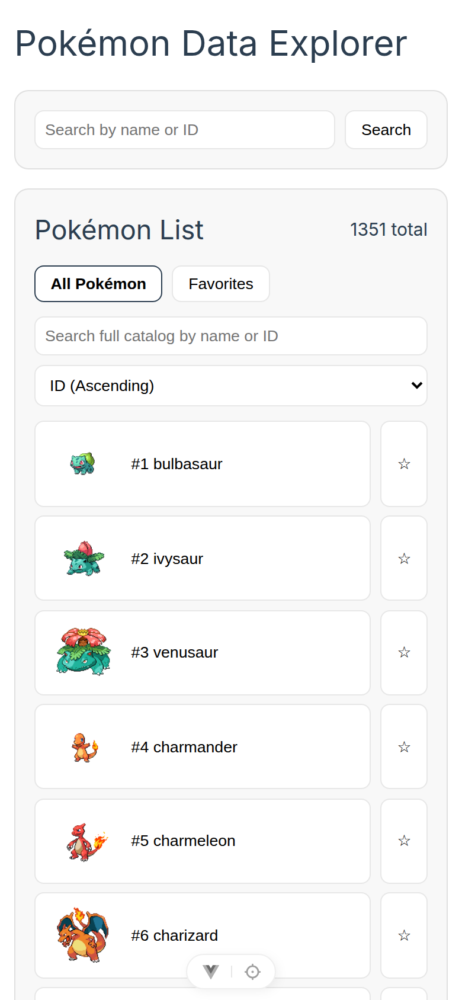
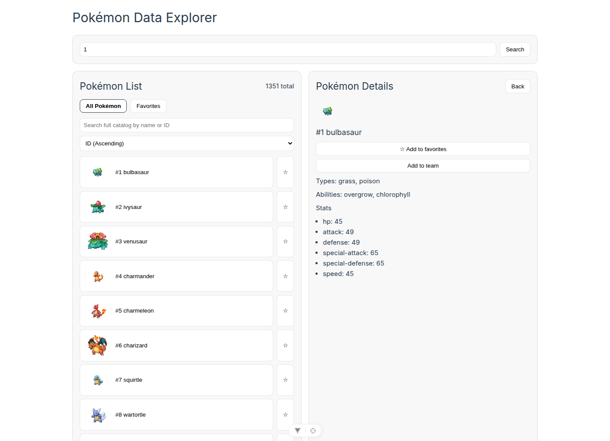

# Frontend brief: Pokémon Data Explorer

This brief is self-contained. Build the UI from this file and the sibling `openapi.json`. You do not have the repository.

The GitHub repository is [rimkahan888/pokemon-api-dotnet](https://github.com/rimkahan888/pokemon-api-dotnet). The ASP.NET Core API already exists. Replace only the Vue app in `pokemon-ui`.

## Product

A single-page explorer for Pokémon data. The API normalizes [PokéAPI](https://pokeapi.co/) into a small JSON contract. People browse a paginated catalog, search the whole catalog by name or ID, open one Pokémon, save favorites, and keep a team of up to six with type coverage and shared weaknesses.

Favorites, the team, and sorting are stored in the browser. They are not API resources.

## Target users

- A fan who wants a fast catalog, not a database admin tool
- Keyboard and small-screen users. The current UI is usable, and the replacement must stay usable
- The owner will drop the generated app back into this repository, so it has to build with the existing toolchain

## Screens and flows

One page is enough. Use clear regions instead of a router unless a route makes the detail view shareable. There is no auth.

1. **Catalog.** On first load, request page 1 with size 20. Show the total count, the current page, previous and next controls, and one row per Pokémon (sprite, id, name, favorite control). Previous is unavailable on page 1. Next is unavailable on the last page. Disable both while a list request is in flight. Ignore stale responses if a newer request was started.
2. **Catalog search.** A query of up to 100 characters searches the full catalog on the server, debounced by 350ms, and resets to page 1. An empty query returns to the unfiltered page. Zero matches is an empty state, not an error.
3. **Detail.** Choosing a row or submitting a name/ID loads one Pokémon. Show sprite, id, name, types, abilities, and base stats. Offer favorite and add-to-team actions. A blank submit tells the user to enter a name or ID and does not call the API. Debounce typed queries by 350ms, separately from catalog search. If responses return out of order, keep the latest request.
4. **Favorites.** A second collection shows saved Pokémon without another list request. Empty state: "No favorites yet." Opening one loads the detail endpoint. Adding or removing a favorite must not require the detail endpoint when the row already has id, name, and sprite.
5. **Team.** Up to six distinct Pokémon, persisted across reloads. Show `n / 6`. Reorder with up and down controls. Removing one frees a slot. Adding a duplicate or a seventh Pokémon does nothing. Below the roster, show type coverage and shared weaknesses. Empty state explains that the team is empty.

Sort the rows currently on screen. Sorting is not sent to the API. Support id ascending, id descending, name A-Z, and name Z-A. Default is id ascending.

## API contract

### Base URL and configuration

Development API: `http://localhost:5010`.

The Vue dev server proxies `/api` to `http://localhost:5010`. The client must call a configurable base:

```ts
const API_BASE = import.meta.env.VITE_API_BASE_URL || '/api'
```

Leave `VITE_API_BASE_URL` unset during `npm run dev` so requests stay same-origin and use the proxy. Set it to `http://localhost:5010/api` only when the built app calls the API directly.

CORS on the API today allows any origin, any header, and any method, without credentials. A browser on another port can call the API directly. Do not send cookies.

`GET /openapi/v1.json` exists only when `ASPNETCORE_ENVIRONMENT=Development`. The checked-in `openapi.json` was exported from that endpoint on 24 October 2026. It lists the two Pokémon operations and their parameters. Response bodies are not in the spec because the actions return `IActionResult`. Use the JSON in this brief for bodies.

`GET /health` is liveness only. It does not call PokéAPI. Captured response: `200` with `Content-Type: text/plain` and body `Healthy`.

There is no request body on any endpoint. There is no write API.

### List and catalog search

`GET /api/pokemon?page={page}&size={size}&search={query}`

| Query | Rules |
| --- | --- |
| `page` | Integer, default 1. Values below 1 are rejected. |
| `size` | Integer, default 20. Must be 1 through 100. |
| `search` | Optional. Omitted or whitespace means the plain page, not a search. Longer than 100 characters is rejected. |

The server page is `offset = (page - 1) * size`. `totalPages` is `ceil(totalCount / size)`. For a non-empty catalog, a page whose offset is past the end returns 400, not an empty list. A search page past the last match returns 200 with `items: []` and the real totals. Do not hardcode the catalog size. It was 1351 when the examples below were captured.

Search is a case-insensitive substring on the PokéAPI name, or a substring of the decimal id. Names in the catalog already use hyphens (`mr-mime`, `pikachu-gmax`). The server does not turn spaces into hyphens, so `mr mime` does not match `mr-mime`. Send the slug or the id.

List sprites are not the upstream sprite. They are `{fallback}/{id}.png` with this default fallback base:

`https://raw.githubusercontent.com/PokeAPI/sprites/master/sprites/pokemon`

Captured `GET /api/pokemon?page=1&size=2`:

```json
{
  "page": 1,
  "size": 2,
  "totalCount": 1351,
  "totalPages": 676,
  "items": [
    {
      "id": 1,
      "name": "bulbasaur",
      "spriteUrl": "https://raw.githubusercontent.com/PokeAPI/sprites/master/sprites/pokemon/1.png"
    },
    {
      "id": 2,
      "name": "ivysaur",
      "spriteUrl": "https://raw.githubusercontent.com/PokeAPI/sprites/master/sprites/pokemon/2.png"
    }
  ]
}
```

Captured `GET /api/pokemon?search=pika&page=1&size=2`:

```json
{
  "page": 1,
  "size": 2,
  "totalCount": 17,
  "totalPages": 9,
  "items": [
    {
      "id": 25,
      "name": "pikachu",
      "spriteUrl": "https://raw.githubusercontent.com/PokeAPI/sprites/master/sprites/pokemon/25.png"
    },
    {
      "id": 10080,
      "name": "pikachu-rock-star",
      "spriteUrl": "https://raw.githubusercontent.com/PokeAPI/sprites/master/sprites/pokemon/10080.png"
    }
  ]
}
```

### Detail

`GET /api/pokemon/{nameOrId}`

`nameOrId` is required, trimmed by the server, and lowercased. It must be 1 to 50 characters. Whitespace is a 400, not a lookup. The value is URL-escaped and sent to PokéAPI as `pokemon/{value}`. Prefer ids or hyphenated slugs.

Captured `GET /api/pokemon/pikachu`:

```json
{
  "id": 25,
  "name": "pikachu",
  "types": ["electric"],
  "abilities": ["static", "lightning-rod"],
  "stats": [
    { "name": "hp", "value": 35 },
    { "name": "attack", "value": 55 },
    { "name": "defense", "value": 40 },
    { "name": "special-attack", "value": 50 },
    { "name": "special-defense", "value": 50 },
    { "name": "speed", "value": 90 }
  ],
  "spriteUrl": "https://raw.githubusercontent.com/PokeAPI/sprites/master/sprites/pokemon/25.png"
}
```

Fields are exactly those. `stats[].value` is the base stat. `spriteUrl` is the upstream front sprite when PokéAPI sends one, otherwise the same fallback URL pattern as the list. Types, abilities, and stats keep upstream order. They may be empty arrays. Do not add height, weight, evolution, or moves. The API does not return them.

### Errors

Failures are JSON objects with one property, `error` (string). There is no problem-details body on the current API. Read `error` and fall back to "Request failed." when the body is not that JSON.

Captured bodies:

| Status | When | Body |
| --- | --- | --- |
| 400 | `page` < 1 | `{"error":"Page must be greater than or equal to 1."}` |
| 400 | `size` outside 1..100 | `{"error":"Size must be between 1 and 100."}` |
| 400 | `search` longer than 100 | `{"error":"Search must be 100 characters or fewer."}` |
| 400 | `nameOrId` blank or longer than 50 | `{"error":"nameOrId must be between 1 and 50 characters."}` |
| 400 | List page past a non-empty catalog | `{"error":"Requested page is out of range."}` |
| 404 | Unknown Pokémon | `{"error":"Pokemon not found."}` |
| 503 | PokéAPI failed after retries | `{"error":"PokéAPI is temporarily unavailable."}` |

The 503 line is the string the controller returns. It was not captured from a live outage. Show these messages. Do not retry forever in the browser. A visible retry action that repeats the same request once the user asks is appropriate.

## Client-only behavior to preserve

### Favorites

`localStorage` keys:

- `pokemon-favorite-ids`: JSON array of positive safe integers, duplicates removed
- `pokemon-favorite-metadata`: JSON array of `{ "id", "name", "spriteUrl" }` for those ids

Ignore corrupt JSON and non-objects. If storage throws, keep the in-memory change for the session.

### Team

Key `pokemon-team`: JSON array of detail objects, at most six, first occurrence of each id wins. Each entry must have a positive integer `id`, string `name`, string array `types`, array `abilities`, array `stats`, and string `spriteUrl`. Drop anything else.

### Type analysis

Use only these 18 types, in this order: normal, fire, water, electric, grass, ice, fighting, poison, ground, flying, psychic, bug, rock, ghost, dragon, dark, steel, fairy. Ignore any other string.

Coverage is the unique team types, sorted in the order above.

A shared weakness is an attacking type whose damage multiplier is at least 2 for two or more team members. For one defender, start at 1 and multiply by each of that Pokémon's types: immune 0, weak 2, resist 0.5, otherwise 1. Dual types multiply. Example: Fire/Flying is immune to Ground, so Ground is not a weakness even though Fire is weak to Ground.

Defensive chart (attacking types that are not neutral):

| Defender | Weak | Resist | Immune |
| --- | --- | --- | --- |
| normal | fighting |  | ghost |
| fire | water, ground, rock | fire, grass, ice, bug, steel, fairy |  |
| water | electric, grass | fire, water, ice, steel |  |
| electric | ground | electric, flying, steel |  |
| grass | fire, ice, poison, flying, bug | water, electric, grass, ground |  |
| ice | fire, fighting, rock, steel | ice |  |
| fighting | flying, psychic, fairy | bug, rock, dark |  |
| poison | ground, psychic | grass, fighting, poison, bug, fairy |  |
| ground | water, grass, ice | poison, rock | electric |
| flying | electric, ice, rock | grass, fighting, bug | ground |
| psychic | bug, ghost, dark | fighting, psychic |  |
| bug | fire, flying, rock | grass, fighting, ground |  |
| rock | water, grass, fighting, ground, steel | normal, fire, poison, flying |  |
| ghost | ghost, dark | poison, bug | normal, fighting |
| dragon | ice, dragon, fairy | fire, water, electric, grass |  |
| dark | fighting, bug, fairy | ghost, dark | psychic |
| steel | fire, fighting, ground | normal, grass, ice, flying, psychic, bug, rock, dragon, steel, fairy | poison |
| fairy | poison, steel | fighting, bug, dark | dragon |

Show coverage as `n of 18 types`. For each shared weakness, show the attacking type, how many team members it hits, and their names.

## Current `pokemon-ui` stack

The app you replace is Vue 3 + TypeScript + Vite 8. Tests are Vitest 3 with jsdom and Vue Test Utils. `vue-tsc` typechecks as part of `npm run build`. Node engines in `package.json` are `^22.18.0 || >=24.12.0`.

```text
pokemon-ui/
  index.html
  package.json
  package-lock.json
  vite.config.ts          @ alias to src, proxy /api -> http://localhost:5010
  vitest.config.ts        merges vite config, environment jsdom
  env.d.ts
  public/favicon.ico
  src/main.ts             mounts App.vue
  src/App.vue             the whole current UI
  src/services/pokemonApi.ts
  src/services/teamAnalysis.ts
  src/types/pokemon.ts
  src/__tests__/App.spec.ts
  src/services/*.spec.ts
  src/assets/base.css
  src/assets/main.css
  src/components/         unused Vite starter components; safe to delete
```

`index.html` currently has an empty `lang` and the title `Vite App`. Fix both.

The current UI is a light layout (dark only when the OS asks), with text buttons such as "Search", "Previous", and "Add to team". Screenshots of that UI, taken against the live API, are in `screenshots/`. They document information architecture only.







## Hard constraints

- Target Vue 3, TypeScript, and Vite. Do not switch to React, Svelte, or a new backend.
- Keep `npm run dev`, `npm test`, and `npm run build` working. `npm run build` must keep the typecheck.
- API base URL is `import.meta.env.VITE_API_BASE_URL`, default `/api`. Do not hardcode `localhost` in components.
- Keep the Vite proxy for `/api`.
- Accessible: real buttons, visible focus, accessible names on icon-only controls, text for errors and loading that assistive tech can announce, respect `prefers-reduced-motion`, contrast that holds on the dark background.
- Responsive at 390px wide and at desktop. The catalog and detail may stack.
- Do not add endpoints or JSON fields. Do not scrape PokéAPI from the browser. Sprites may load from the `spriteUrl` the API returns.
- Do not require accounts, databases, or new services.

## Visual direction

This is the target, not a description of the screenshots.

- Dark theme by default, without waiting for the operating system
- Minimalist: few borders, lots of the sprite, short labels
- Icons over text labels for search, previous, next, favorite, add, remove, and reorder. The accessible name still says what the control does
- Type and stat information can stay textual
- One accent color, used for focus and the active collection

## Integration contract

Generate files that drop into the existing `pokemon-ui` directory. Do not create a second app folder.

```text
pokemon-ui/
  .env.example                 VITE_API_BASE_URL=/api
  index.html                   lang="en", title "Pokémon Data Explorer"
  package.json                 keep the current scripts and Vue 3 toolchain
  vite.config.ts               keep the @ alias and the /api proxy
  src/main.ts
  src/App.vue                  or src/views plus src/components, mounted from main.ts
  src/services/pokemonApi.ts   fetch wrappers for the two GET endpoints
  src/services/teamAnalysis.ts the chart and rules above
  src/types/pokemon.ts         the interfaces below
  src/__tests__/               Vitest coverage of the flows above
  src/assets/                  dark theme styles
```

TypeScript types, matching the JSON property names:

```ts
export interface PokemonStat {
  name: string
  value: number
}

export interface PokemonDetail {
  id: number
  name: string
  types: string[]
  abilities: string[]
  stats: PokemonStat[]
  spriteUrl: string
}

export interface PokemonSummary {
  id: number
  name: string
  spriteUrl: string
}

export interface PokemonPage {
  page: number
  size: number
  totalCount: number
  totalPages: number
  items: PokemonSummary[]
}
```

How the owner will run it:

```bash
dotnet run --project PokemonApi
cd pokemon-ui
npm ci
npm run dev
```

The API listens on `http://localhost:5010`. Vite serves the UI and proxies `/api`. Verify with `npm test` and `npm run build` before handing the folder back.

To refresh `openapi.json` from a Development build of the API, run `docs/frontend-handoff/export-openapi.sh` from the repository root. It starts the API, downloads `/openapi/v1.json`, and pretty-prints this file.
